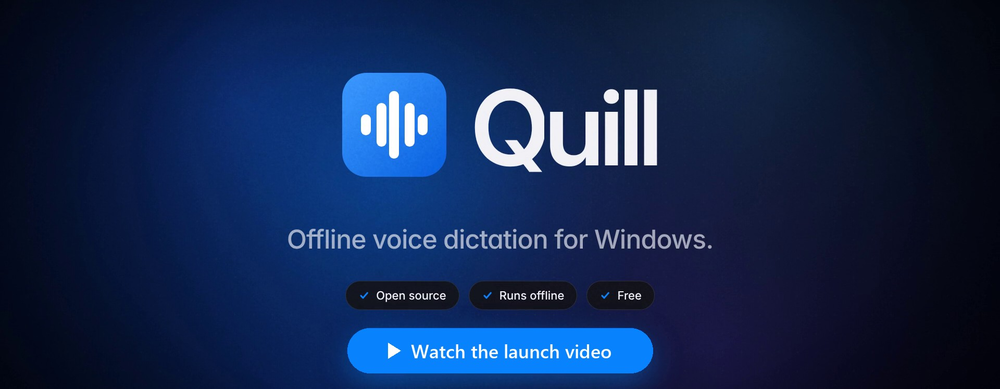
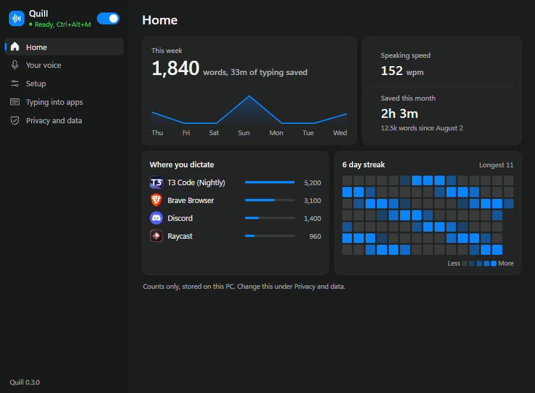
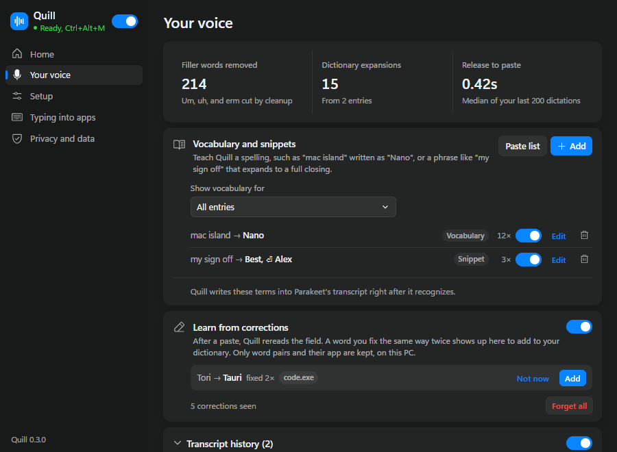

# Quill

 

Offline voice dictation for Windows 10 and 11. Hold a shortcut, speak, and release to paste text into the app you are using. Recognition and cleanup run on your PC.

[Download Quill-Setup.exe](https://github.com/valenxi0/Quill/releases/latest/download/Quill-Setup.exe)

The installer supports 64-bit Windows and installs without an admin prompt. Models download during setup. After that, dictation works offline.

## How to use Quill

Hold **Ctrl+Alt+M** to record, then release to paste. Toggle mode lets you press once to start and again to finish. Press Esc twice within one second to cancel.

Quill runs in the system tray. Settings has six pages: Home for your week, Your voice for vocabulary and history, Setup for the shortcut, engine, and cleanup style, Typing into apps for how text lands in each app, Sketch, and Privacy and data.

Press **Ctrl+Alt+S** to start a Sketch: talk while you mark up the screen, holding Shift and moving the pointer to draw. Press it again, and Quill pastes the screenshots and what you said at each one into the app you started in. It's made for showing an AI agent what you mean. The idea comes from [Scrawl](https://github.com/kitlangton/scrawl) by Kit Langton.

Turn on Live preview in Setup to see the words Quill hears while you speak. Say "press enter" at the end of a dictation to send it, once that option is on. To paste the last transcript again, use the tray menu or `quill://paste-last`.

Quill uses a dark interface, including the window title bar, even when Windows uses light mode.

## Speech engines and cleanup

Parakeet + S1-mini is the default engine. S1-mini cleans English transcripts and can remove fillers, fix punctuation, and format spoken lists. Choose Verbatim, Casual, Polished, or Compose to control the result, and pick a different style for specific apps, such as Casual in Discord. Whisper Tiny, Base, Turbo, and Cohere Transcribe are also available.

Quill fits each dictation to where it lands. In the middle of a sentence it starts lowercase and drops a full stop the sentence doesn't need. In terminals it writes spoken commands as commands and pastes long text in pieces, so Claude Code and Codex show it instead of a placeholder. Say an emoji name followed by "emoji", such as "thumbs up emoji", to type the emoji. A built-in voice activity detector skips silence before recognition.

Add vocabulary for names and terms, or snippets for text you repeat. Choose All apps or a specific app in the entry editor. App entries override matching global entries, so "Rust" in your code editor can stay "rust" in chat. Quill suggests dictionary entries when you make the same correction twice in an app.

Screenshots use sample data.

## Privacy

Quill processes audio in memory and discards it after transcription. Recognition and cleanup do not send audio or text to a server. Downloads and update checks need an internet connection.

Sketch screenshots are saved on your PC, in `%LOCALAPPDATA%\Quill\Sketches`, for 24 hours.

Insights store counts on your PC, including words dictated and the app you used. Transcript history is off by default. If you enable it, Quill keeps what it heard and what it pasted on your PC for 24 hours, and you can redo any entry in another style. You can turn both features off in Settings.

## Install and update

See the [setup guide](docs/SETUP-GUIDE.md) for installation and troubleshooting. Quill checks for updates daily when the GitHub release feed is accessible. Running the latest installer over your copy keeps your settings and downloaded models.

Release notes are in the [changelog](docs/CHANGELOG.md). The installer also includes CHANGELOG.md in the Quill installation folder.

Releases are not code-signed, so Windows may warn before installing. Each release is built from this repository by GitHub Actions. If Smart App Control blocks the installer, see [Troubleshooting](#troubleshooting).

## Build and contribute

Quill uses Rust and Tauri, with React and TypeScript for Settings and the recording overlay. See [Development](docs/DEVELOPMENT.md) for build instructions, bug reports, and pull requests.

Quill is [MIT licensed](LICENSE). Bundled runtimes and downloaded models have their own licenses, listed in the development guide and in Settings under Privacy and data.

## Troubleshooting

If Windows 11 says **"Smart App Control blocked an app"** when installing or opening Quill, you can turn it off under **Windows Security > App & browser control > Smart App Control settings > Off**, then retry. This disables that protection for all apps. Updated Windows versions let you turn it back on; older versions may require a Windows reset or reinstall. See [Microsoft's Smart App Control FAQ](https://support.microsoft.com/en-us/windows/security/threat-malware-protection/smart-app-control-frequently-asked-questions).

For other installation, microphone, or shortcut issues, see the [setup guide](docs/SETUP-GUIDE.md#troubleshooting).
