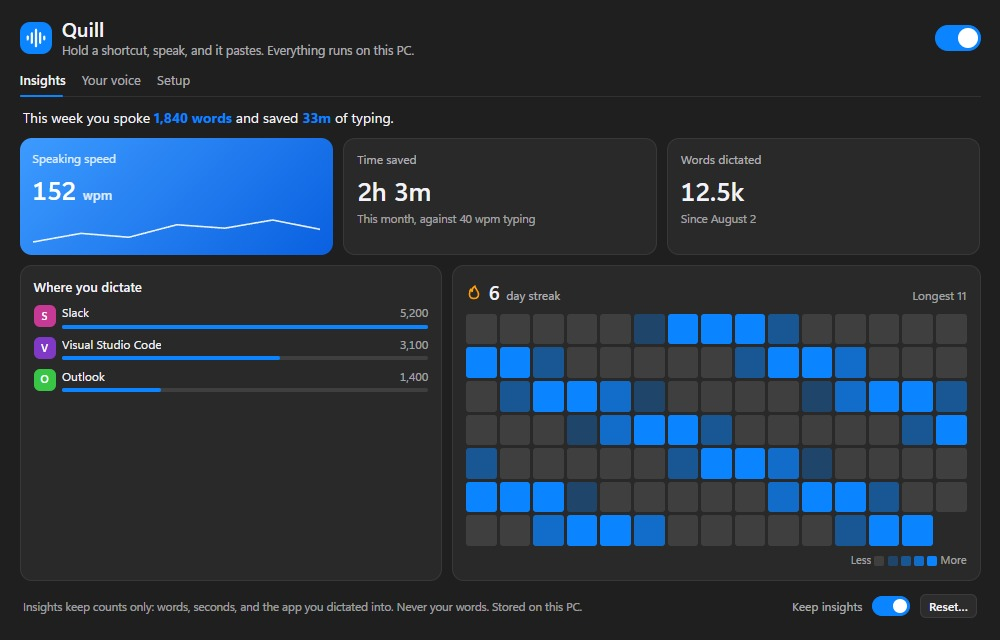
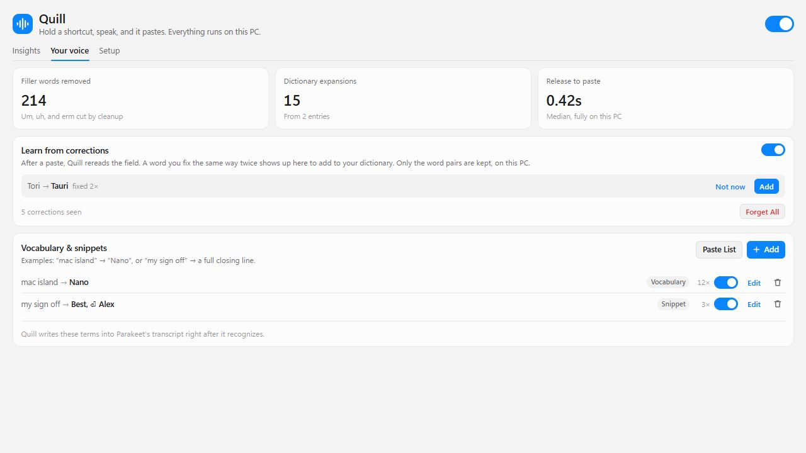

# Quill

 

Offline voice dictation for Windows 10 and 11. Hold a shortcut, speak, and release to paste text into the app you are using. Recognition and cleanup run on your PC.

[Download Quill-Setup.exe](https://github.com/valenxi0/Quill/releases/latest/download/Quill-Setup.exe)

The installer supports 64-bit Windows and installs without an admin prompt. Models download during setup. After that, dictation works offline.

## How to use Quill

Hold **Ctrl+Alt+M** to record, then release to paste. Toggle mode lets you press once to start and again to finish. Press Esc twice within one second to cancel.

Quill runs in the system tray. Open Settings to change your shortcut, choose an engine, or enable Start at login. Setup has a collapsible engine picker, with extra controls under Advanced.

Quill uses a dark interface, including the window title bar, even when Windows uses light mode.

## Speech engines and cleanup

Parakeet + S1-mini is the default engine. S1-mini cleans English transcripts and can remove fillers, fix punctuation, and format spoken lists. Choose Verbatim, Casual, Polished, or Compose to control the result. Whisper Tiny, Base, Turbo, and Cohere Transcribe are also available.

Add vocabulary for names and terms, or snippets for text you repeat. Choose All apps or a specific app in the entry editor. App entries override matching global entries, so "Rust" in your code editor can stay "rust" in chat. Quill suggests dictionary entries when you make the same correction twice in an app.

Screenshots use sample data.

## Privacy

Quill processes audio in memory and discards it after transcription. Recognition and cleanup do not send audio or text to a server. Downloads and update checks need an internet connection.

Insights store counts on your PC, including words dictated and the app you used. Transcript history is off by default. If you enable it, Quill keeps the final text on your PC for 24 hours. You can turn both features off in Settings.

## Install and update

See the [setup guide](docs/SETUP-GUIDE.md) for installation and troubleshooting. Quill checks for updates daily when the GitHub release feed is accessible. Running the latest installer over your copy keeps your settings and downloaded models.

Release notes are in the [changelog](docs/CHANGELOG.md). The installer also includes CHANGELOG.md in the Quill installation folder.

## Build and contribute

Quill uses Rust and Tauri, with React and TypeScript for Settings and the recording overlay. See [Development](docs/DEVELOPMENT.md) for build instructions and [Contributing](CONTRIBUTING.md) for bug reports and pull requests.

Quill is [MIT licensed](LICENSE). Bundled runtimes and downloaded models have their own licenses, listed in the development guide and in Setup under Licenses.

## Troubleshooting

If Windows 11 says **"Smart App Control blocked an app"** when installing or opening Quill, you can turn it off under **Windows Security > App & browser control > Smart App Control settings > Off**, then retry. This disables that protection for all apps. Updated Windows versions let you turn it back on; older versions may require a Windows reset or reinstall. See [Microsoft's Smart App Control FAQ](https://support.microsoft.com/en-us/windows/security/threat-malware-protection/smart-app-control-frequently-asked-questions).

For other installation, microphone, or shortcut issues, see the [setup guide](docs/SETUP-GUIDE.md#troubleshooting).
