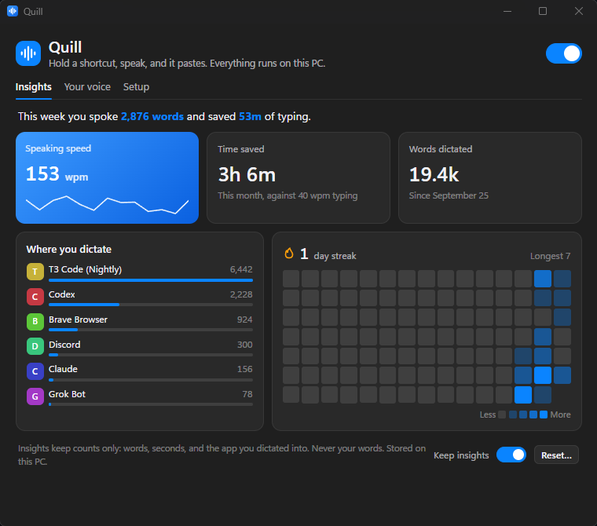
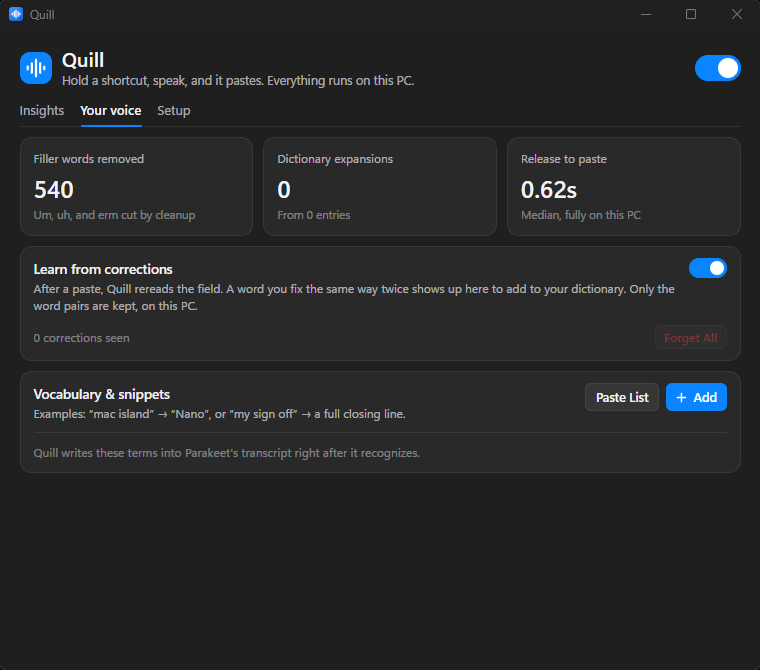

# Quill

**Your voice, wherever you type.**

Local dictation for Windows. Hold a shortcut, speak, and let go to paste.

[**Download Quill-Setup.exe**](https://github.com/valenxi0/Quill/releases/latest/download/Quill-Setup.exe) · [Setup guide](docs/SETUP-GUIDE.md) · [Changelog](docs/CHANGELOG.md)

Windows 10 / 11 · x64 · MIT licensed

## Speak. Release. Done.

Hold **Ctrl+Alt+M**, say what you want to write, and release. Quill pastes into the app you're using. Prefer a toggle? Press once to start and again to finish. **Esc** cancels.

- **Runs on your PC.** Recognition and cleanup happen locally. Audio stays in memory and is discarded after transcription.
- **Choose your engine.** Parakeet + S1-mini is the default. Whisper Tiny, Base, Turbo, and Cohere Transcribe are also available. Models download only when you ask.
- **Write your way.** Choose Verbatim, Casual, Polished, or Compose. Add vocabulary and snippets for the words you use every day.
- **See your progress.** Track words dictated, speaking speed, and time saved. Insights keep counts, never your words.
- **Ready in the tray.** Set your shortcut, enable Start at login, and dictate without keeping a window open.

<strong>Your voice: vocabulary, snippets, and corrections</strong>

## Get started

1. Download and run [**Quill-Setup.exe**](https://github.com/valenxi0/Quill/releases/latest/download/Quill-Setup.exe). Installation is per-user, with no admin prompt.
2. Choose your shortcut and download an engine during setup.
3. Click into a text field and try your first dictation.

Open Quill from the tray to change settings. Setup keeps the essentials up front, with an expandable engine picker and extra controls under **Advanced**.

Quill checks for updates daily when the GitHub release feed is accessible. You can also run the latest installer over your copy; settings and downloaded models are kept. See the [setup guide](docs/SETUP-GUIDE.md) for installation and troubleshooting.

## Build & contribute

Quill uses **Rust + Tauri**, with **React + TypeScript** for the settings window and recording overlay.

See [Development](docs/DEVELOPMENT.md) for prerequisites, builds, tests, and model licenses, and [Contributing](CONTRIBUTING.md) to get involved. Performance measurements live in [Benchmarks](docs/BENCHMARKS.md).

Quill is [MIT licensed](LICENSE). Speech models and bundled runtimes have their own licenses, listed in the development guide and in **Setup → Licenses**.
